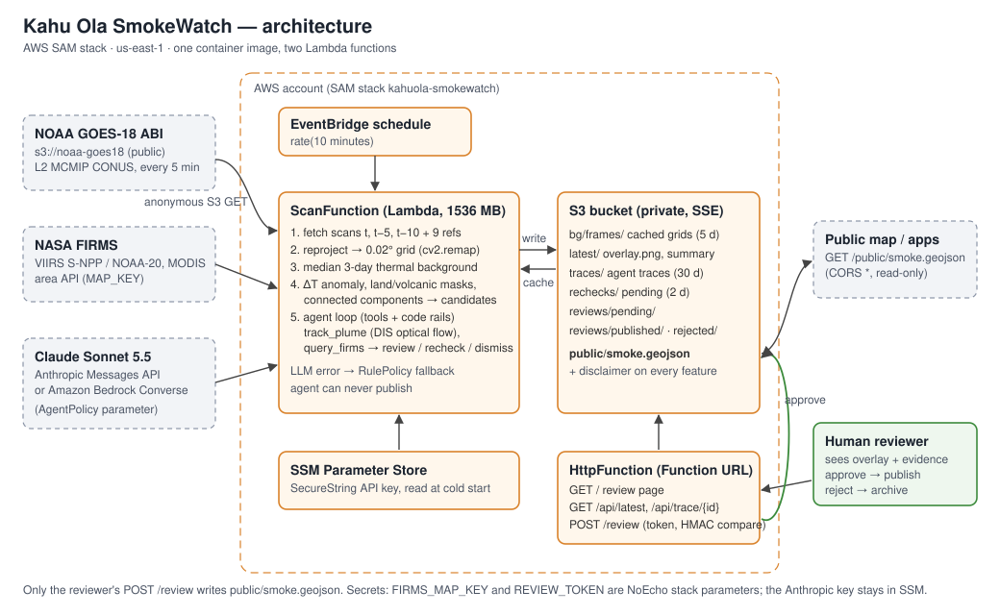

# Kahu Ola SmokeWatch

Wildfire detection for Hawaiʻi from GOES-18, every 5 minutes, with an agent that gathers
evidence and a human who decides what is published.

* **Perception (OpenCV):** each GOES-18 ABI scan is reprojected to a 0.02° Hawaiʻi grid. The
  3.9 µm channel is compared with a cloud-screened median of the same clock time on the
  3 previous days. Thermal anomalies on land become candidates. Kīlauea and Mauna Loa are
  masked as volcanic.
* **Agent:** for each candidate the agent calls `track_plume` (persistence across earlier
  scans, smoke plume, DIS optical flow) and `query_firms` (VIIRS/MODIS). It then requests
  human review, re-checks, or dismisses. Code rails decide what can reach a reviewer; the
  agent can never publish.
* **Human in the loop:** a reviewer approves or rejects on a small web page. Only approved
  detections enter the public GeoJSON layer, and every feature carries the disclaimer
  *"Ước tính tự động từ vệ tinh, không thay thế cảnh báo chính thức"* (automated satellite
  estimate, not a substitute for official warnings).

## Demo video

[https://youtu.be/ZwM0HbwoKGk](https://youtu.be/ZwM0HbwoKGk) (3:59, narration is AI-generated). It shows the Lahaina case study and the timeline
viewer on the live page, the deployed image replaying the 01:36Z scan with Claude, a human
approving the review, the architecture, and the evaluation. Rebuild: `video/tools/`.



Details: [REPORT.md](REPORT.md) · agent flow: [docs/agent-workflow.svg](docs/agent-workflow.svg) ·
example trace: [docs/agent-trace-example.md](docs/agent-trace-example.md) · evaluation:
[eval/results.md](eval/results.md).

## Repository layout

| Path | What |
|---|---|
| `smokewatch/goes.py` | GOES-18 MCMIP access (public S3, anonymous), reprojection, `.npz` cache |
| `smokewatch/fire.py` | thermal background, anomaly test, volcanic zones, candidates |
| `smokewatch/vision.py` | smoke evidence, optical flow, overlays |
| `smokewatch/agent.py` | tools, safety rails, `RulePolicy` / `AnthropicPolicy` / `BedrockPolicy` |
| `smokewatch/firms.py` | NASA FIRMS lookups (API or offline archive) |
| `handler.py` | Lambda entry points: `scan` (scheduled), `http` (review page + API) |
| `template.yaml`, `Dockerfile` | AWS SAM stack (one container image, two functions) |
| `eval/` | cases with sources (`cases.yaml`), eval runner, results |
| `scripts/` | local replay, policy comparison, helpers |

## Requirements

* Python 3.13 and [uv](https://docs.astral.sh/uv/) (or `pip`)
* For deploy: AWS CLI v2, AWS SAM CLI, Docker (Desktop) with BuildKit
* Optional secrets (never committed):
  * `FIRMS_MAP_KEY`: NASA FIRMS map key (free), for live FIRMS lookups and NOAA-20 in eval
  * an Anthropic API key in SSM, for `AgentPolicy=anthropic`
  * `REVIEW_TOKEN`: the reviewer's shared secret (≥ 24 chars)

## Local setup and tests

```bash
uv venv --python 3.13 .venv
uv pip install --python .venv/bin/python -r requirements-dev.txt   # pinned versions
.venv/bin/python -m pytest -q
```

The tests use synthetic scenes and stubbed LLM clients; they need no network or credentials.

## Replay one scan locally

```bash
.venv/bin/python scripts/run_local.py --time 2023-08-09T01:36Z --policy rules --out ./out
```

This downloads the needed GOES frames (current, t−5, t−10 and the 3-day background) into
`.cache/goes` and writes the overlay, trace and summary to `./out`. Use
`--policy anthropic` with `ANTHROPIC_KEY_PARAM=/smokewatch/anthropic_api_key` set, or
`ANTHROPIC_API_KEY` in the shell, to run the LLM agent instead.

Compare the deterministic and LLM policies on identical inputs:

```bash
ANTHROPIC_KEY_PARAM=/smokewatch/anthropic_api_key FIRMS_ARCHIVE_DIR=.cache/firms \
  .venv/bin/python scripts/compare_policies.py --llm anthropic \
  --time 2023-08-09T01:21Z --time 2023-08-09T01:36Z
```

## Evaluation

The cases (7 fires of Aug 2023 with official first-report times and sources, plus 5 negative
days: clear, cloudy, vog ×2, sun glint) are in `eval/cases.yaml`.

1. Put the keyless FIRMS yearly country archives for 2023 in `.cache/firms/`:
   `snpp_2023_US.csv` and `modis_2023_US.csv` from
   `https://firms.modaps.eosdis.nasa.gov/data/country/{viirs-snpp,modis}/2023/`.
2. Optional: create `.env.local` (gitignored) with `FIRMS_MAP_KEY=...`, so NOAA-20 is
   included in the "first polar-orbiter detection" comparison.
3. Run detached. The run is resumable: cached frames and finished cases are skipped.

```bash
mkdir -p eval/logs
nohup eval/run_all.sh > eval/logs/run_all.log 2>&1 &
```

Outputs: `eval/results.md`, `eval/results.json`, and per-case stores in `eval/runs/`
(traces, overlays, failure gallery). The first full run downloads about 300 GOES frames.

## Deploy to AWS

```bash
# 1. secret for the LLM agent (only if AgentPolicy=anthropic); paste the key at the prompt
read -rs KEY && aws ssm put-parameter --name /smokewatch/anthropic_api_key \
  --type SecureString --value "$KEY" && unset KEY

# 2. build (BuildKit is needed with Docker Desktop's containerd image store)
sam build --use-buildkit

# 3. first deploy: guided, answers saved to samconfig.toml (gitignored)
sam deploy --guided
#   ReviewToken:  openssl rand -hex 24
#   FirmsMapKey:  your FIRMS key (or empty)
#   AgentPolicy:  rules | anthropic | bedrock

# later deploys (parameters not given keep their previous values)
sam build --use-buildkit && sam deploy --parameter-overrides AgentPolicy=anthropic
```

Stack outputs: `ReviewUrl` (review page, `/api/latest`, `/public/smoke.geojson`), `Bucket`,
`ScanFunctionName`.

* **ScanFunction:** runs every 10 min. On first start it bootstraps the 3-day background
  from NOAA within the 300 s timeout and caches the grids in `s3://<bucket>/bg/frames/`.
  Detection starts once ≥ 3 reference scans exist.
* **HttpFunction:** serves the review page, JSON API, and public layer. `POST /review` takes
  `{review_id, decision: approve|reject, token}`. The token is compared in constant time
  with `REVIEW_TOKEN`.
* **IAM:** S3 access to the stack bucket only. `ssm:GetParameter` on the single key
  parameter, and only for `AgentPolicy=anthropic`. `bedrock:InvokeModel` on the configured
  model only, and only for `AgentPolicy=bedrock`.

Check the deployment:

```bash
aws logs tail /aws/lambda/<ScanFunctionName> --since 30m
curl -s <ReviewUrl>/api/latest | python -m json.tool | head -40
```

## Public page, archive and featured events

`GET /` opens with the Lahaina case study: timeline, an OpenCV-rendered animation, the agent
trace, and the evaluation table. Below that are a timeline viewer and the live status. The
reviewer page is at `/review`.

* **Layers** (all on the same 0.02° grid, toggled in the browser):
  * true color by day, a dark land/sea canvas by night;
  * the **ΔT anomaly**: Δ(3.9 − 11.2 µm) above the 3-day background, which is what the
    detector tests;
  * coastline;
  * FIRMS points.
* **Live archive:** every scan writes `archive/YYYY/MM/DD/HHMMZ/` (`overlay.webp`,
  `anomaly.png`, `summary.json`) and updates `archive/index/YYYY-MM-DD.json`. The index is
  written to a temporary key, then copied into place. Days are **Hawaiʻi (HST) calendar days**,
  so a fire evening stays on one day. `archive/` expires after 90 days. Scans with a review
  are also copied to `events/`, which is kept.
* **Featured event:** the 8 Aug 2023 Maui fires are backfilled from the evaluation cache, with
  no NOAA download:

  ```bash
  FIRMS_ARCHIVE_DIR=.cache/firms python scripts/backfill_events.py --out out/site
  aws s3 sync out/site/events s3://<bucket>/events/ && aws s3 sync out/site/static s3://<bucket>/static/
  ```

  This also renders `events/media/lahaina-2023-08-08.mp4` (cv2.VideoWriter, H.264) and a GIF
  fallback (cv2.imwriteanimation).
* **Deep links:** `?date=2023-08-08&t=0136Z` (HST day, UTC time of the scan; `&region=maui`,
  `&play=1`).
* **Images** are served through `GET /img/<key>`, which redirects to a presigned S3 URL
  (cached 1 h). Scan `summary.json` files are returned inline, so the browser's `fetch()`
  stays same-origin (the bucket has no CORS). Only keys under `archive/`, `events/` and
  `static/` are served. The bucket stays private.
* **Limitation:** the viewer shows only days stored by the live scanner and featured events.
  It does not fetch arbitrary past dates from NOAA on demand. The replay days show the
  RulePolicy decisions of the evaluation run.
* **Local preview:** `LOCAL_STORE=out/site python scripts/serve_local.py`, then open
  http://127.0.0.1:8765/.

## Safety properties

* The agent never publishes; only `POST /review` with the reviewer token does.
* Review needs `track_plume`, ≥ 2 scans with the hotspot, and a location outside the
  volcanic mask (enforced in code).
* LLM, network or FIRMS failures never stop a scan: the deterministic `RulePolicy` resolves
  whatever is left open, and the error is recorded in the trace.
* No personal data is stored. No secrets in code, env files in git, or `samconfig.toml`
  (gitignored).

## Access for judges

The repository is private. The owner adds each judge as a read-only collaborator:

```bash
gh api -X PUT repos/nguyenhuulong2222/kahuola-smokewatch/collaborators/<github-username> -f permission=pull
```

(or GitHub → Settings → Collaborators → Add people). The live page needs no account: the
`ReviewUrl` stack output. Approving reviews needs the reviewer token, which is shared
separately on request.

## Data sources

NOAA GOES-18 ABI L2 MCMIP (NOAA Open Data Dissemination, AWS). NASA FIRMS (VIIRS S-NPP,
NOAA-20, MODIS). Natural Earth 10 m land. Event times and locations: see the citations in
`eval/cases.yaml`.

## License

Copyright 2026 Long Nguyen / Kahu Ola. Licensed under the [Apache License 2.0](LICENSE); see
[NOTICE](NOTICE) for third-party data.
