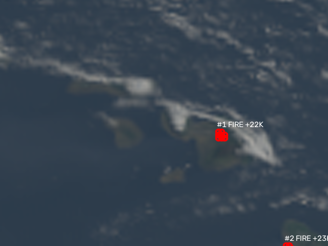
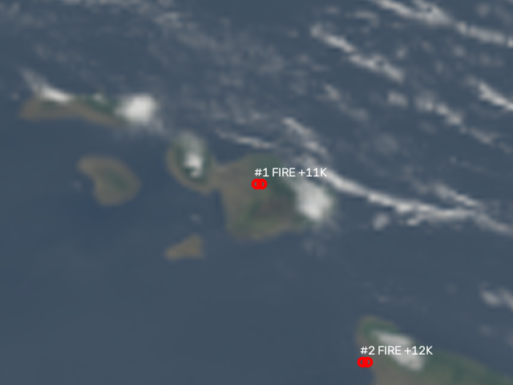
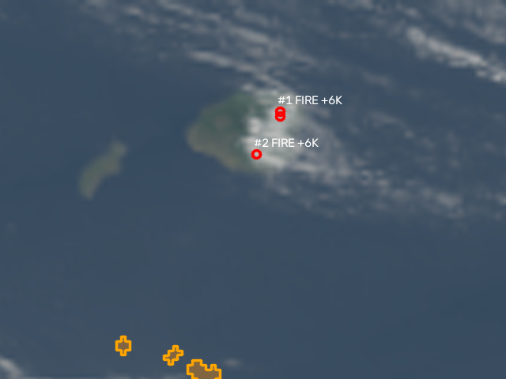
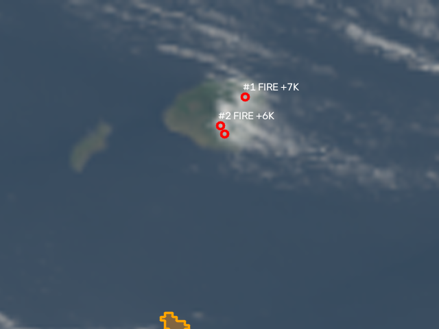
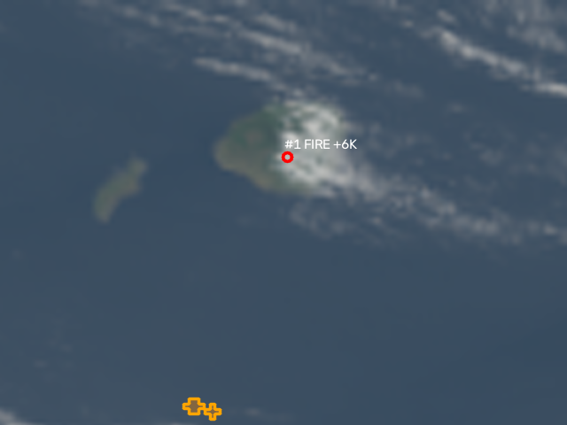
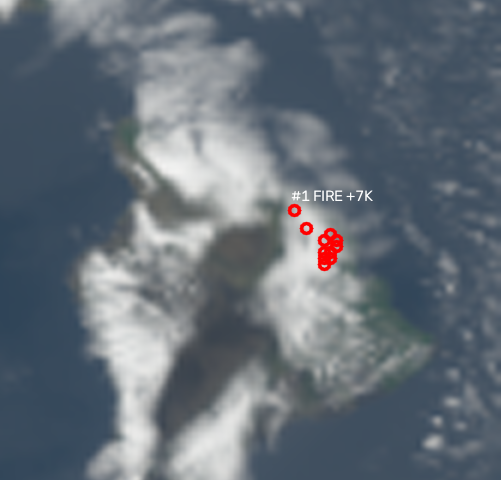
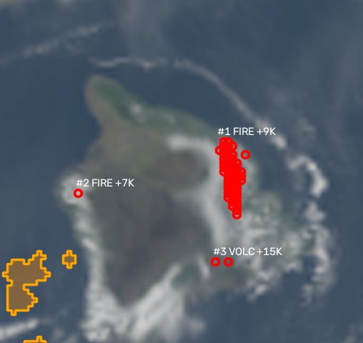
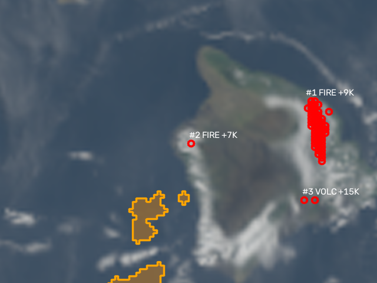
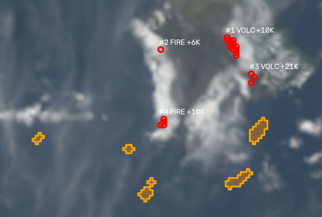
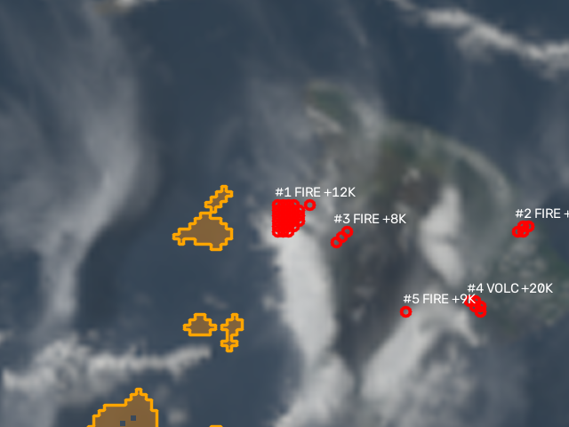

# SmokeWatch evaluation

Generated 2026-10-25T07:45Z · policy `rules` · 148 unique GOES-18 PACUS scans. Cases: `eval/cases.yaml`.

## Time to detection

First GOES scan where the agent queued a human review within the radius of the origin, vs the official first-report time and vs the first FIRMS detection by any polar-orbiting sensor. Polar sensors: NOAA-20 not included (no FIRMS_MAP_KEY; not in the keyless archive); S-NPP VIIRS and MODIS Aqua/Terra from the FIRMS archive. Δ: + = GOES later, − = GOES earlier.

| Fire | Official first report | First thermal anomaly | **First GOES review** | Δ vs report | First polar-orbiter detection (sensor) | **Δ vs first polar** |
|---|---|---|---|---|---|---|
| Olinda fire (Upcountry Maui) | 08-08 10:22Z (00:22 HST) | 08-08 11:16Z (01:16 HST) | **08-08 11:21Z (01:21 HST)** | +59m | 08-08 11:44Z (01:44 HST) (VIIRS_SNPP) | **−23m** |
| Lahaina morning fire (Lahainaluna Rd) | 08-08 16:34Z (06:34 HST) | — | **—** | — | 08-09 07:50Z (21:50 HST) (MODIS_Terra) | **—** |
| Kula fire (Kualono Pl) | 08-08 21:27Z (11:27 HST) | — | **—** | — | 08-08 23:45Z (13:45 HST) (VIIRS_NOAA20) | **—** |
| Lahaina afternoon fire (rekindle, Kuʻialua St) | 08-09 00:55Z (14:55 HST) | 08-09 01:21Z (15:21 HST) | **08-09 01:36Z (15:36 HST)** | +41m | 08-09 07:50Z (21:50 HST) (MODIS_Terra) | **−6h14m** |
| Pūlehu–Kīhei fire | 08-09 04:01Z (18:01 HST) | 08-09 05:41Z (19:41 HST) | **08-09 05:41Z (19:41 HST)** | +1h40m | 08-09 07:50Z (21:50 HST) (MODIS_Terra) | **−2h09m** |
| North Kohala (Akoni Pule Hwy) fire, Hawaiʻi Island | 08-08 13:00Z (03:00 HST) | 08-08 13:36Z (03:36 HST) | **08-08 13:41Z (03:41 HST)** | +41m | 08-08 20:57Z (10:57 HST) (MODIS_Terra) | **−7h16m** |
| Mauna Kea Resort / Kawaihae fires, Hawaiʻi Island | 08-09 01:00Z (15:00 HST) | 08-09 01:26Z (15:26 HST) | **08-09 01:31Z (15:31 HST)** | +31m | 08-09 11:25Z (01:25 HST) (VIIRS_SNPP) | **−9h54m** |

In words (GOES review vs official report vs first polar-orbiter pass):

- Olinda fire (Upcountry Maui): GOES review 59 min after the official first report, 23 min before the first polar-orbiter detection (VIIRS_SNPP).
- Lahaina morning fire (Lahainaluna Rd): not detected by GOES in 30 scans.
- Kula fire (Kualono Pl): not detected by GOES in 27 scans.
- Lahaina afternoon fire (rekindle, Kuʻialua St): GOES review 41 min after the official first report, ~6 h before the first polar-orbiter detection (MODIS_Terra).
- Pūlehu–Kīhei fire: GOES review 1 h 40 min after the official first report, 2 h 09 min before the first polar-orbiter detection (MODIS_Terra).
- North Kohala (Akoni Pule Hwy) fire, Hawaiʻi Island: GOES review 41 min after the official first report, ~7 h before the first polar-orbiter detection (MODIS_Terra).
- Mauna Kea Resort / Kawaihae fires, Hawaiʻi Island: GOES review 31 min after the official first report, ~10 h before the first polar-orbiter detection (VIIRS_SNPP).

Per-sensor first detection within the radius:

- olinda: VIIRS_SNPP 08-08 11:44Z (01:44 HST), MODIS_Aqua 08-08 12:23Z (02:23 HST), VIIRS_NOAA20 08-08 12:33Z (02:33 HST), MODIS_Terra 08-08 20:56Z (10:56 HST)
- lahaina_am: MODIS_Terra 08-09 07:50Z (21:50 HST), VIIRS_SNPP 08-09 11:25Z (01:25 HST), VIIRS_NOAA20 08-09 12:15Z (02:15 HST), MODIS_Aqua 08-09 13:05Z (03:05 HST)
- kula: VIIRS_NOAA20 08-08 23:45Z (13:45 HST), VIIRS_SNPP 08-09 00:36Z (14:36 HST), MODIS_Terra 08-09 07:50Z (21:50 HST), MODIS_Aqua 08-09 13:05Z (03:05 HST)
- lahaina_pm: MODIS_Terra 08-09 07:50Z (21:50 HST), VIIRS_SNPP 08-09 11:25Z (01:25 HST), VIIRS_NOAA20 08-09 12:15Z (02:15 HST), MODIS_Aqua 08-09 13:05Z (03:05 HST)
- pulehu: MODIS_Terra 08-09 07:50Z (21:50 HST), VIIRS_SNPP 08-09 11:25Z (01:25 HST), VIIRS_NOAA20 08-09 12:15Z (02:15 HST), MODIS_Aqua 08-09 13:05Z (03:05 HST)
- kohala_ranch: MODIS_Terra 08-08 20:57Z (10:57 HST), VIIRS_SNPP 08-08 22:55Z (12:55 HST), VIIRS_NOAA20 08-08 23:45Z (13:45 HST)
- mauna_kea_resort: VIIRS_SNPP 08-09 11:25Z (01:25 HST), VIIRS_NOAA20 08-09 12:15Z (02:15 HST)

Sources per fire (time / origin):

- **Olinda fire (Upcountry Maui)** — time: F1 p.31, F2, AAR p.10 (primary); origin 20.8087, -156.2829 (AAR p.10 + OSM geocode); match radius 4 km; 17 scans replayed.
- **Lahaina morning fire (Lahainaluna Rd)** — time: F2, F1, AAR (primary); origin 20.8847, -156.663 (F2 §3.7.7 (primary)); match radius 4 km; 30 scans replayed.
- **Kula fire (Kualono Pl)** — time: F1, F2, AAR (primary); origin 20.7724, -156.3069 (F1/AAR address + OSM geocode); match radius 3 km; 27 scans replayed.
- **Lahaina afternoon fire (rekindle, Kuʻialua St)** — time: F1, F2, AAR (primary). ATF news coverage cites ~14:25 HST; not verified; origin 20.8847, -156.663 (F2 (primary)); match radius 4 km; 13 scans replayed.
- **Pūlehu–Kīhei fire** — time: F1 p.32, AAR p.13 (primary); origin 20.8002, -156.3701 (F1/AAR address + OSM geocode); match radius 3 km; 25 scans replayed.
- **North Kohala (Akoni Pule Hwy) fire, Hawaiʻi Island** — time: bigislandnow.com 2023-08-08; bigislandvideonews.com 2023-08-08 (secondary, approximate); origin 20.0902, -155.8312 (news + OSM geocode (secondary)); match radius 6 km; 17 scans replayed.
- **Mauna Kea Resort / Kawaihae fires, Hawaiʻi Island** — time: bigislandnow.com 2023-08-08 (secondary, approximate); origin 20.0069, -155.8262 (news + OSM geocode (secondary)); match radius 6 km; 12 scans replayed.

First-review rationale (generated from evidence):

- *olinda*: Hotspot at 20.820N 156.300W: 1 px, Δ(3.9−11.2 µm) +7.5 K vs same time on previous days; present in 2/3 scans over 10 min (11:16Z, 11:21Z); night — smoke not observable; FIRMS: no VIIRS/MODIS detection in prior 24 h (GOES ahead of polar passes); flagged on 1 earlier scan(s)
- *lahaina_pm*: Hotspot at 20.880N 156.670W: 2 px, Δ(3.9−11.2 µm) +10.5 K vs same time on previous days; present in 3/3 scans over 10 min (01:26Z, 01:31Z, 01:36Z); no smoke plume attached; FIRMS: no VIIRS/MODIS detection in prior 24 h (GOES ahead of polar passes); flagged on 1 earlier scan(s)
- *pulehu*: Hotspot at 20.792N 156.345W: 19 px, Δ(3.9−11.2 µm) +43.4 K vs same time on previous days; present in 3/3 scans over 10 min (05:31Z, 05:36Z, 05:41Z); night — smoke not observable; FIRMS: 71 VIIRS/MODIS detections in prior 24 h, nearest 3.8 km, latest 00:36Z
- *kohala_ranch*: Hotspot at 20.090N 155.860W: 2 px, Δ(3.9−11.2 µm) +10.7 K vs same time on previous days; present in 2/3 scans over 10 min (13:36Z, 13:41Z); night — smoke not observable; FIRMS: no VIIRS/MODIS detection in prior 24 h (GOES ahead of polar passes); flagged on 1 earlier scan(s)
- *mauna_kea_resort*: Hotspot at 20.013N 155.827W: 3 px, Δ(3.9−11.2 µm) +18.2 K vs same time on previous days; present in 2/3 scans over 10 min (01:26Z, 01:31Z); no smoke plume attached; FIRMS: 1 VIIRS/MODIS detections in prior 24 h, nearest 7.1 km, latest 20:57Z; flagged on 1 earlier scan(s)

## Precision

- Reviews: **207 TP / 34 FP → precision 0.859** (per review, unique frames, positive + negative days).
- Negative-day frames with any false review: **6 / 19**.
- Of the 34 strict FPs, **22 are corroborated by FIRMS** (≥1 vegetation-fire detection within 3 km, ±24 h) — fire spreading beyond the origin radius or a fire not listed; counting those as real fires would give precision 0.95. The remaining 12 have no corroboration and are listed first under Failure cases.

| Negative case | Kind | Frames | Reviews (all FP) | Volcanic dismissed | FIRMS non-volcanic pts that day | Label source |
|---|---|---|---|---|---|---|
| clear_0806 | clear | 4 | 1 | 2 | 1 | No Maui/Hawaiʻi Island fires reported 5–6 Aug 2023 in AAR/F1/news (absence of evidence); FIRMS archive: only Kīlauea/Mauna Loa volcanic detections on these dates. |
| vog_0110 | vog | 4 | 0 | 0 | 34 | Kīlauea summit eruption 5 Jan–7 Mar 2023 (USGS HVO); vog over Honolulu 10 Jan 2023 (Hawaii News Now, secondary). Also exercises the volcanic exclusion mask. |
| vog_0912 | vog | 4 | 7 | 5 | 5 | Kīlauea summit eruption 10–16 Sep 2023 (USGS HVO); DOH release 11 Sep 2023 vog on west Hawaiʻi Island; Pāhala unhealthy for sensitive groups 12 Sep (HPR). |
| glint_0615 | glint | 3 | 0 | 1 | 25 | Near-solstice afternoon: GOES-18 specular point nearest Hawaiʻi ~13:00–15:00 HST. Kīlauea summit erupting 7–19 Jun 2023 (USGS HVO). |
| cloudy_0128 | cloudy | 4 | 1 | 0 | 0 | Measured: 84% of land pixels C13 < 273 K at 2023-01-28 23:01Z (eval/logs/cloudy.log); winter, no wildfire reports found; Kīlauea summit erupting (USGS HVO). |

## Latency (local replay, cached frames)

| Step | median s | max s |
|---|---|---|
| frame | 0.01 | 71.13 |
| background | 0.07 | 84.11 |
| agent | 0.04 | 0.59 |
| tool `track_plume` | 0.00 | 0.17 |
| tool `schedule_recheck` | 0.00 | 0.00 |
| tool `query_firms` | 0.00 | 0.56 |
| tool `request_human_review` | 0.01 | 0.07 |
| tool `dismiss` | 0.00 | 0.00 |

## Failure cases

- **Missed: Lahaina morning fire (Lahainaluna Rd)** — no review within 4 km in 30 scans. 
- **Missed: Kula fire (Kualono Pl)** — no review within 3 km in 27 scans. 
- **FP — no FIRMS corroboration** — kula 08-08 21:16Z at 21.960, -159.500 (+6.4 K): Hotspot at 21.960N 159.500W: 1 px, Δ(3.9−11.2 µm) +6.4 K vs same time on previous days; present in 2/3 scans over 10 min (21:11Z, 21:16Z); no smoke plume attached; FIRMS: no VIIRS/MODIS detection in prior 24 h (GOES ahead of polar passes) 
- **FP — no FIRMS corroboration** — kula 08-08 21:21Z at 21.980, -159.510 (+6.0 K): Hotspot at 21.980N 159.510W: 2 px, Δ(3.9−11.2 µm) +6.0 K vs same time on previous days; present in 3/3 scans over 10 min (21:11Z, 21:16Z, 21:21Z); no smoke plume attached; FIRMS: no VIIRS/MODIS detection in prior 24 h (GOES ahead of polar passes) 
- **FP — no FIRMS corroboration** — kula 08-08 21:26Z at 22.020, -159.520 (+6.2 K): Hotspot at 22.020N 159.520W: 1 px, Δ(3.9−11.2 µm) +6.2 K vs same time on previous days; present in 2/3 scans over 10 min (21:21Z, 21:26Z); no smoke plume attached; FIRMS: no VIIRS/MODIS detection in prior 24 h (GOES ahead of polar passes) 
- **FP — no FIRMS corroboration** — clear_0806 08-06 23:01Z at 19.847, -155.202 (+6.9 K): Hotspot at 19.847N 155.202W: 11 px, Δ(3.9−11.2 µm) +6.9 K vs same time on previous days; present in 3/3 scans over 10 min (22:51Z, 22:56Z, 23:01Z); no smoke plume attached; FIRMS: no VIIRS/MODIS detection in prior 24 h (GOES ahead of polar passes) 
- **FP — no FIRMS corroboration** — vog_0912 09-12 20:01Z at 19.809, -155.224 (+9.3 K): Hotspot at 19.809N 155.224W: 54 px, Δ(3.9−11.2 µm) +9.3 K vs same time on previous days; present in 3/3 scans over 10 min (19:51Z, 19:56Z, 20:01Z); no smoke plume attached; FIRMS: no VIIRS/MODIS detection in prior 24 h (GOES ahead of polar passes) 
- **FP — no FIRMS corroboration** — vog_0912 09-12 20:01Z at 19.720, -155.940 (+7.2 K): Hotspot at 19.720N 155.940W: 1 px, Δ(3.9−11.2 µm) +7.2 K vs same time on previous days; present in 2/3 scans over 10 min (19:56Z, 20:01Z); no smoke plume attached; FIRMS: no VIIRS/MODIS detection in prior 24 h (GOES ahead of polar passes) 
- **FP — no FIRMS corroboration** — vog_0912 09-12 23:01Z at 19.115, -155.845 (+9.5 K): Hotspot at 19.115N 155.845W: 4 px, Δ(3.9−11.2 µm) +9.5 K vs same time on previous days; present in 3/3 scans over 10 min (22:51Z, 22:56Z, 23:01Z); no smoke plume attached; FIRMS: no VIIRS/MODIS detection in prior 24 h (GOES ahead of polar passes) 
- **FP — no FIRMS corroboration** — vog_0912 09-13 01:01Z at 19.755, -155.962 (+12.0 K): Hotspot at 19.755N 155.962W: 27 px, Δ(3.9−11.2 µm) +12.0 K vs same time on previous days; present in 3/3 scans over 10 min (00:51Z, 00:56Z, 01:01Z); no smoke plume attached; FIRMS: no VIIRS/MODIS detection in prior 24 h (GOES ahead of polar passes) 
- **FP — no FIRMS corroboration** — vog_0912 09-13 01:01Z at 19.710, -155.080 (+11.1 K): Hotspot at 19.710N 155.080W: 4 px, Δ(3.9−11.2 µm) +11.1 K vs same time on previous days; present in 2/3 scans over 10 min (00:56Z, 01:01Z); no smoke plume attached; FIRMS: no VIIRS/MODIS detection in prior 24 h (GOES ahead of polar passes)
- **FP — no FIRMS corroboration** — vog_0912 09-13 01:01Z at 19.680, -155.760 (+8.3 K): Hotspot at 19.680N 155.760W: 3 px, Δ(3.9−11.2 µm) +8.3 K vs same time on previous days; present in 2/3 scans over 10 min (00:56Z, 01:01Z); no smoke plume attached; FIRMS: no VIIRS/MODIS detection in prior 24 h (GOES ahead of polar passes)
- **FP — no FIRMS corroboration** — vog_0912 09-13 09:01Z at 19.987, -155.193 (+8.3 K): Hotspot at 19.987N 155.193W: 3 px, Δ(3.9−11.2 µm) +8.3 K vs same time on previous days; present in 3/3 scans over 10 min (08:51Z, 08:56Z, 09:01Z); night — smoke not observable; FIRMS: no VIIRS/MODIS detection in prior 24 h (GOES ahead of polar passes)
- **FP — no FIRMS corroboration** — cloudy_0128 01-29 09:01Z at 21.200, -156.730 (+7.4 K): Hotspot at 21.200N 156.730W: 2 px, Δ(3.9−11.2 µm) +7.4 K vs same time on previous days; present in 2/3 scans over 10 min (08:56Z, 09:01Z); night — smoke not observable; FIRMS: no VIIRS/MODIS detection in prior 24 h (GOES ahead of polar passes)
- **FP — FIRMS-corroborated (37 pts), 4.5 km from a known origin** — lahaina_am 08-08 17:01Z at 20.830, -156.320 (+28.6 K): Hotspot at 20.830N 156.320W: 6 px, Δ(3.9−11.2 µm) +28.6 K vs same time on previous days; present in 2/2 scans over 10 min (16:51Z, 17:01Z); no smoke plume attached; FIRMS: 23 VIIRS/MODIS detections in prior 24 h, nearest 2.5 km, latest 12:33Z
- **FP — FIRMS-corroborated (43 pts), 3.2 km from a known origin** — pulehu 08-09 04:06Z at 20.795, -156.326 (+28.0 K): Hotspot at 20.795N 156.326W: 16 px, Δ(3.9−11.2 µm) +28.0 K vs same time on previous days; present in 3/3 scans over 10 min (03:56Z, 04:01Z, 04:06Z); no smoke plume attached; FIRMS: 71 VIIRS/MODIS detections in prior 24 h, nearest 2.2 km, latest 00:36Z
- **FP — FIRMS-corroborated (59 pts), 3.2 km from a known origin** — pulehu 08-09 04:11Z at 20.797, -156.323 (+28.2 K): Hotspot at 20.797N 156.323W: 12 px, Δ(3.9−11.2 µm) +28.2 K vs same time on previous days; present in 3/3 scans over 10 min (04:01Z, 04:06Z, 04:11Z); no smoke plume attached; FIRMS: 71 VIIRS/MODIS detections in prior 24 h, nearest 1.9 km, latest 00:36Z
- **FP — FIRMS-corroborated (16 pts), 3.6 km from a known origin** — pulehu 08-09 04:16Z at 20.796, -156.336 (+38.2 K): Hotspot at 20.796N 156.336W: 19 px, Δ(3.9−11.2 µm) +38.2 K vs same time on previous days; present in 3/3 scans over 10 min (04:06Z, 04:11Z, 04:16Z); no smoke plume attached; FIRMS: 71 VIIRS/MODIS detections in prior 24 h, nearest 2.7 km, latest 00:36Z
- **FP — FIRMS-corroborated (18 pts), 3.2 km from a known origin** — pulehu 08-09 04:21Z at 20.796, -156.340 (+58.1 K): Hotspot at 20.796N 156.340W: 21 px, Δ(3.9−11.2 µm) +58.1 K vs same time on previous days; present in 3/3 scans over 10 min (04:11Z, 04:16Z, 04:21Z); no smoke plume attached; FIRMS: 71 VIIRS/MODIS detections in prior 24 h, nearest 3.1 km, latest 00:36Z
- **FP — FIRMS-corroborated (25 pts), 3.6 km from a known origin** — pulehu 08-09 04:26Z at 20.794, -156.332 (+28.9 K): Hotspot at 20.794N 156.332W: 18 px, Δ(3.9−11.2 µm) +28.9 K vs same time on previous days; present in 3/3 scans over 10 min (04:16Z, 04:21Z, 04:26Z); no smoke plume attached; FIRMS: 71 VIIRS/MODIS detections in prior 24 h, nearest 2.6 km, latest 00:36Z
- **FP — FIRMS-corroborated (23 pts), 3.8 km from a known origin** — pulehu 08-09 04:31Z at 20.797, -156.332 (+29.4 K): Hotspot at 20.797N 156.332W: 19 px, Δ(3.9−11.2 µm) +29.4 K vs same time on previous days; present in 3/3 scans over 10 min (04:21Z, 04:26Z, 04:31Z); no smoke plume attached; FIRMS: 71 VIIRS/MODIS detections in prior 24 h, nearest 2.3 km, latest 00:36Z
- **FP — FIRMS-corroborated (18 pts), 3.7 km from a known origin** — pulehu 08-09 04:36Z at 20.796, -156.335 (+44.5 K): Hotspot at 20.796N 156.335W: 20 px, Δ(3.9−11.2 µm) +44.5 K vs same time on previous days; present in 3/3 scans over 10 min (04:26Z, 04:31Z, 04:36Z); no smoke plume attached; FIRMS: 71 VIIRS/MODIS detections in prior 24 h, nearest 2.7 km, latest 00:36Z
- **FP — FIRMS-corroborated (21 pts), 3.7 km from a known origin** — pulehu 08-09 04:41Z at 20.794, -156.335 (+28.7 K): Hotspot at 20.794N 156.335W: 17 px, Δ(3.9−11.2 µm) +28.7 K vs same time on previous days; present in 3/3 scans over 10 min (04:31Z, 04:36Z, 04:41Z); no smoke plume attached; FIRMS: 71 VIIRS/MODIS detections in prior 24 h, nearest 2.8 km, latest 00:36Z
- **FP — FIRMS-corroborated (25 pts), 3.6 km from a known origin** — pulehu 08-09 04:46Z at 20.794, -156.332 (+31.1 K): Hotspot at 20.794N 156.332W: 18 px, Δ(3.9−11.2 µm) +31.1 K vs same time on previous days; present in 3/3 scans over 10 min (04:36Z, 04:41Z, 04:46Z); no smoke plume attached; FIRMS: 71 VIIRS/MODIS detections in prior 24 h, nearest 2.6 km, latest 00:36Z
- **FP — FIRMS-corroborated (28 pts), 3.6 km from a known origin** — pulehu 08-09 04:51Z at 20.796, -156.330 (+35.9 K): Hotspot at 20.796N 156.330W: 16 px, Δ(3.9−11.2 µm) +35.9 K vs same time on previous days; present in 3/3 scans over 10 min (04:41Z, 04:46Z, 04:51Z); night — smoke not observable; FIRMS: 71 VIIRS/MODIS detections in prior 24 h, nearest 2.3 km, latest 00:36Z
- **FP — FIRMS-corroborated (20 pts), 3.2 km from a known origin** — pulehu 08-09 04:56Z at 20.795, -156.340 (+55.0 K): Hotspot at 20.795N 156.340W: 22 px, Δ(3.9−11.2 µm) +55.0 K vs same time on previous days; present in 3/3 scans over 10 min (04:46Z, 04:51Z, 04:56Z); night — smoke not observable; FIRMS: 71 VIIRS/MODIS detections in prior 24 h, nearest 3.2 km, latest 00:36Z
- **FP — FIRMS-corroborated (21 pts), 3.7 km from a known origin** — pulehu 08-09 05:01Z at 20.794, -156.335 (+37.6 K): Hotspot at 20.794N 156.335W: 17 px, Δ(3.9−11.2 µm) +37.6 K vs same time on previous days; present in 3/3 scans over 10 min (04:51Z, 04:56Z, 05:01Z); night — smoke not observable; FIRMS: 71 VIIRS/MODIS detections in prior 24 h, nearest 2.8 km, latest 00:36Z
- **FP — FIRMS-corroborated (16 pts), 3.4 km from a known origin** — pulehu 08-09 05:06Z at 20.796, -156.338 (+37.6 K): Hotspot at 20.796N 156.338W: 20 px, Δ(3.9−11.2 µm) +37.6 K vs same time on previous days; present in 3/3 scans over 10 min (04:56Z, 05:01Z, 05:06Z); night — smoke not observable; FIRMS: 71 VIIRS/MODIS detections in prior 24 h, nearest 2.9 km, latest 00:36Z
- **FP — FIRMS-corroborated (26 pts), 3.0 km from a known origin** — pulehu 08-09 05:11Z at 20.793, -156.342 (+38.5 K): Hotspot at 20.793N 156.342W: 20 px, Δ(3.9−11.2 µm) +38.5 K vs same time on previous days; present in 3/3 scans over 10 min (05:01Z, 05:06Z, 05:11Z); night — smoke not observable; FIRMS: 71 VIIRS/MODIS detections in prior 24 h, nearest 3.4 km, latest 00:36Z
- **FP — FIRMS-corroborated (20 pts), 3.2 km from a known origin** — pulehu 08-09 05:16Z at 20.795, -156.340 (+56.5 K): Hotspot at 20.795N 156.340W: 22 px, Δ(3.9−11.2 µm) +56.5 K vs same time on previous days; present in 3/3 scans over 10 min (05:06Z, 05:11Z, 05:16Z); night — smoke not observable; FIRMS: 71 VIIRS/MODIS detections in prior 24 h, nearest 3.2 km, latest 00:36Z
- **FP — FIRMS-corroborated (26 pts), 3.0 km from a known origin** — pulehu 08-09 05:21Z at 20.793, -156.342 (+48.1 K): Hotspot at 20.793N 156.342W: 20 px, Δ(3.9−11.2 µm) +48.1 K vs same time on previous days; present in 3/3 scans over 10 min (05:11Z, 05:16Z, 05:21Z); night — smoke not observable; FIRMS: 71 VIIRS/MODIS detections in prior 24 h, nearest 3.4 km, latest 00:36Z
- **FP — FIRMS-corroborated (26 pts), 3.0 km from a known origin** — pulehu 08-09 05:26Z at 20.793, -156.342 (+39.8 K): Hotspot at 20.793N 156.342W: 20 px, Δ(3.9−11.2 µm) +39.8 K vs same time on previous days; present in 3/3 scans over 10 min (05:16Z, 05:21Z, 05:26Z); night — smoke not observable; FIRMS: 71 VIIRS/MODIS detections in prior 24 h, nearest 3.4 km, latest 00:36Z
- **FP — FIRMS-corroborated (26 pts), 3.0 km from a known origin** — pulehu 08-09 05:31Z at 20.793, -156.342 (+51.7 K): Hotspot at 20.793N 156.342W: 20 px, Δ(3.9−11.2 µm) +51.7 K vs same time on previous days; present in 3/3 scans over 10 min (05:21Z, 05:26Z, 05:31Z); night — smoke not observable; FIRMS: 71 VIIRS/MODIS detections in prior 24 h, nearest 3.4 km, latest 00:36Z
- **FP — FIRMS-corroborated (26 pts), 3.0 km from a known origin** — pulehu 08-09 05:36Z at 20.793, -156.342 (+50.4 K): Hotspot at 20.793N 156.342W: 20 px, Δ(3.9−11.2 µm) +50.4 K vs same time on previous days; present in 3/3 scans over 10 min (05:26Z, 05:31Z, 05:36Z); night — smoke not observable; FIRMS: 71 VIIRS/MODIS detections in prior 24 h, nearest 3.4 km, latest 00:36Z
- **FP — FIRMS-corroborated (27 pts), 3.1 km from a known origin** — pulehu 08-09 05:46Z at 20.792, -156.342 (+40.1 K): Hotspot at 20.792N 156.342W: 20 px, Δ(3.9−11.2 µm) +40.1 K vs same time on previous days; present in 3/3 scans over 10 min (05:36Z, 05:41Z, 05:46Z); night — smoke not observable; FIRMS: 71 VIIRS/MODIS detections in prior 24 h, nearest 3.5 km, latest 00:36Z
- **FP — FIRMS-corroborated (26 pts), 3.0 km from a known origin** — pulehu 08-09 05:51Z at 20.793, -156.342 (+42.1 K): Hotspot at 20.793N 156.342W: 20 px, Δ(3.9−11.2 µm) +42.1 K vs same time on previous days; present in 3/3 scans over 10 min (05:41Z, 05:46Z, 05:51Z); night — smoke not observable; FIRMS: 71 VIIRS/MODIS detections in prior 24 h, nearest 3.4 km, latest 00:36Z
